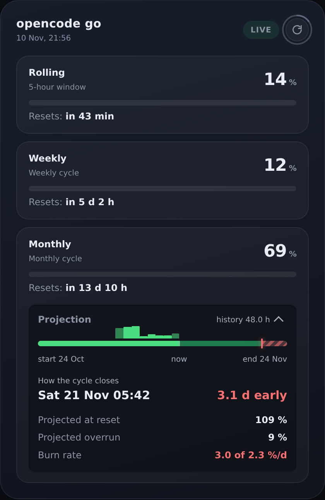

<div align="center">


**Three quota buckets. One burn rate. The date you run dry — before you run dry.**



[](#run)
[](#what-it-is)
[](LICENSE)
[](#endpoints)

```bash
git clone https://github.com/hrodres/opencode-quota-dashboard.git
cd opencode-quota-dashboard && python3 serve.py
```

</div>

## What it is

opencode go answers `/usage` with three percentages and three timestamps. That
tells you where you are, never where you are heading — and the monthly bucket is
the one that can end your week.

Runway is one Python file that serves the card above. No build, no CDN, no web
fonts, no model names.

## What it does

- **The ceiling** — `(100 − current) / days to reset`, exact arithmetic, no model.
  How much you can spend per day and still reach the reset alive.
- **The projected close** — current % plus your measured burn rate times the days
  left, and the date you hit 100 % if you keep going.

Read together they say what a percentage cannot: `2.0 of 2.4 %/d` is under the
ceiling with a little air. `3.8 of 2.4` runs dry before the reset, and the card
names the day. The bars above the projection line are consumption per day,
YouTube "most replayed" style: height is the data, colour is not.

**Your key never leaves the machine.** It is read locally and used only in an
outbound request header; the browser receives percentages, nothing else. If
upstream fails the card keeps the last good reading, flags it stale and turns the
pill amber instead of blanking. Querying `/usage` costs no quota — it is a
billing endpoint, not inference.

## Run

Python 3.9+ and an opencode go key. That is the whole list. The key is found from
the first matching source:

| # | Method | How |
|---|---|---|
| 1 | Environment variable | `export OPENCODE_GO_API_KEY=sk-...` |
| 2 | Key file by path | `export OPENCODE_GO_KEY_FILE=/path/to/key` |
| 3 | Key file next to the script | `echo 'sk-...' > api_key` |
| 4 | Existing OpenClaw install | `openclaw.json` — plain key or SecretRef |

Sources 1–3 are independent of OpenClaw; it is **optional** here. Source 4 also
reads SecretRefs from the gateway's SQLite secret store.

```bash
python3 serve.py --check          # which key, and does upstream answer
python3 serve.py                  # http://127.0.0.1:8099/
python3 serve.py --bind 0.0.0.0   # reachable from your phone
./install.sh                      # systemd unit, survives logout
```

`--check` prints the last 4 characters of the key, never the key.
`--port auto` starts at 8099 and takes the first free port, so an occupied port
is never a manual decision. `BIND=auto` picks **loopback** on a machine with a
graphical session and **LAN** on a headless host. There is no authentication, so
startup warns when the resulting address is not loopback. `./install.sh` runs
`--check` first, writes the unit and confirms the URL answers, or prints the
foreground command instead if it cannot write to systemd. It never prompts.

## How it works

The monthly percentage is sampled every ten minutes; `state.json` keeps **35
days**, one full cycle, so the per-day bars are not born half empty.

- **Burn rate** is the chord across the last **48 hours**, not the whole history:
  a 7-day window drags in old spikes and overestimated this account by 3.3×.
  Against 24 h and 7 d it won at the horizon that matters (MAE 3.09 vs 4.31 vs
  3.39 pp).
- **The series is cut at the last reset.** A window spanning a reset can look
  positive by accident (5 % before, 8 % three days later reads as +3) and yield a
  rate that is nonsense while looking fine.
- **Days are marked incomplete, not guessed.** Today's figure is a `max − min`
  floor, so those bars sit at 55 % opacity and say `in progress` on hover.
- **One rounding, two figures.** Projected close and margin come from the same
  rounded number, so they add to 100. Rounding them apart gave 87 + 14 = 101.

The upstream `percent` is an **integer**, so the rate is a chord between whole
steps of a gauge. With little movement in the window, ±1 point is most of the
signal and three honest estimators can disagree by 40 %. That is why the
projection carries **no decimals** — a decimal would claim a resolution the
source does not have. The comparison holds even when the figure does not: *under*
or *over* the ceiling survives the whole plausible range of rates. Until two
samples exist the basis reads `estimated cycle` and assumes even consumption.

## Configuration

| Variable | Default | Purpose |
|---|---|---|
| `OPENCODE_GO_API_KEY` | — | Your key (highest priority) |
| `OPENCODE_GO_KEY_FILE` | — | Path to a file containing the key |
| `OPENCODE_GO_USAGE_URL` | opencode endpoint | Override the API endpoint |
| `PORT` | `auto` from `8099` | HTTP port, or the first free one |
| `BIND` | `auto` | Listen address; loopback with a display, LAN when headless |
| `CACHE_TTL` | `60` | Upstream cache, seconds |
| `STALE_AFTER` | `300` | Age at which data is flagged stale |
| `STATE_FILE` | `./state.json` | Where usage samples are kept |
| `GO_TZ` | `UTC` | Timezone for days and log timestamps |
| `OPENCLAW_HOME` | `~/.openclaw` | Only for the optional OpenClaw path |

Flags `--port`, `--bind`, `--json` and `--check` override the environment.

## Endpoints

| Route | Content |
|---|---|
| `/` | The dashboard |
| `/quota.json` | Live quota + projection, cached 60 s |
| `/healthz` | `{ok, age_s, stale, error}` |

`/quota.json` exists because the page consumes it, and stays useful for another
client. Only `GET` is implemented; the server never serves its own source or
`state.json`.

## Known limitations

- **No authentication.** Built for loopback, LAN or a VPN. Do not put this on the
  open internet as-is.
- **Account-wide only.** The endpoint aggregates the account; there is no
  per-model breakdown.
- **`state.json` is disposable.** Delete it any time; the projection rebuilds
  from scratch. A cycle in progress keeps its gap.
- **The endpoint is undocumented.** opencode may change it;
  `OPENCODE_GO_USAGE_URL` repoints it without editing code.

## Troubleshooting

```bash
python3 serve.py --check
```

| Output | Meaning |
|---|---|
| `key : NOT FOUND` | None of the four sources matched. Set one. |
| `HTTP 401` | The key is not valid. |
| `HTTP 429` | Rate limited. The 60 s cache normally prevents this. |
| `response has no usage field` | The endpoint changed shape. |
| Projection hidden | Not enough history yet, or the reset has passed. |

## License

MIT — see [LICENSE](LICENSE).

<details>
<summary>Deploy it with an agent</summary>

Paste this into OpenClaw, or any coding agent with shell access:

> Clone https://github.com/hrodres/opencode-quota-dashboard and set it up for
> me. Follow its AGENTS.md. Tell me the URL when it answers.

That is the entire instruction. `AGENTS.md` is written for the agent, not for
you, and covers the port, the key, the service and the failure modes.

Under the hood it runs one command, which prints **exactly one JSON object**:

```bash
$ ./install.sh --json
{"ok": true, "url": "http://192.168.1.50:8100/", "local_url": "http://127.0.0.1:8100/",
 "port": 8100, "bind": "0.0.0.0", "key_source": "openclaw secret store",
 "key_tail": "-D5O", "upstream": "ok", "installed": 1, "answering": 1}
```

`url` is the one to open from another device. `key_tail` is 4 characters, never
the key.

</details>

<details>
<summary>The card as plain text</summary>

For a terminal or anything that cannot render the image above:

```text
  opencode go                         10 Nov, 18:32   ● LIVE   ↻
  ─────────────────────────────────────────────────────────────
  Rolling    5-hour window       3 %   ▏▏▏                  in 4 h 8 min
  Weekly     weekly cycle        7 %   ▏▏▏▏▏                in 5 d 5 h
  Monthly    monthly cycle      67 %   ▏▏▏▏▏▏▏▏▏▏▏▏▏▏       in 13 d 13 h
             ▁▂▃█▄▂▁▁▂ ···································
             start 24 Oct        now                end 24 Nov
             How the cycle closes      closes at 94 %   margin 3.0 d
             Projected at reset                             94 %
             Remaining margin                               +6 %
             Burn rate                              2.0 of 2.4 %/d
```

</details>
